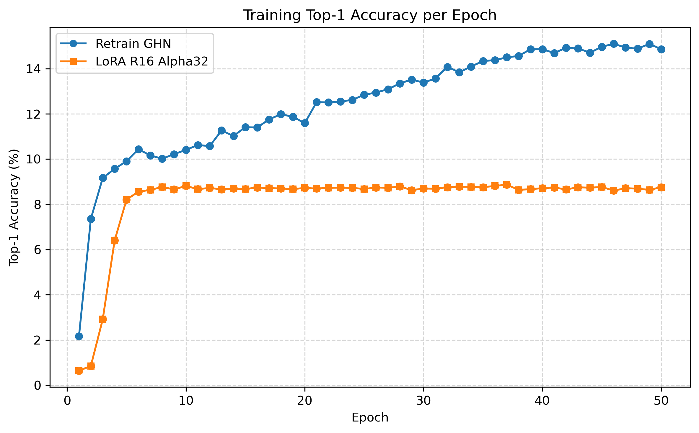
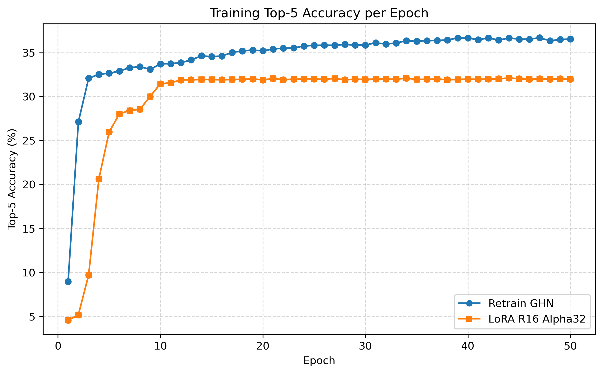

# GHN-3 LoRA: Parameter-Efficient Fine-Tuning for New Datasets

This repository extends the original **GHN-3** implementation with support for parameter-efficient fine-tuning using **Low-Rank Adaptation (LoRA)** and training on the **Caltech-101** dataset.

The goal of this project is to investigate whether a pretrained GHN-3 can be adapted to a new image classification dataset using LoRA instead of retraining the entire model. The implementation and evaluation are based on the work presented in my RIT Master's Capstone.

## Features

- LoRA integration for GHN-3
- Support for Caltech-101 dataset in GHN-3 training
- Loading ImageNet-pretrained GHN-3 checkpoints with selective weight initialization
- Full retraining and LoRA fine-tuning pipelines

## Results

Compared to conventional full retraining on Caltech-101:

| Model                 | Total Parameters | Trainable Parameters |
| --------------------- | ---------------: | -------------------: |
| Fully retrained GHN-3 |        7,986,052 |     7,986,052 (100%) |
| LoRA fine-tuned GHN-3 |        7,986,052 |   1,209,420 (15.14%) |

| Hyperparameter  |  Value |
| --------------- | -----: |
| Learning rate   | `5e-5` |
| Meta batch size |      8 |
| Batch size      |     32 |
| LoRA rank       |     16 |
| LoRA alpha      |     32 |
| LoRA dropout    |   0.05 |

### Training Accuracy

**Top-1 accuracy per epoch**



**Top-5 accuracy per epoch**



## Conclusion

This project demonstrates that LoRA can adapt an ImageNet-pretrained GHN-3 to Caltech-101 without updating the full model.

- LoRA reduced trainable parameters from **100%** to **15.14%**
- Approximately **9% reduction** in training time
- LoRA converged faster during training
- Final Top-1 accuracy remained approximately **5–6%** below full retraining while requiring substantially fewer trainable parameters.

These results highlight LoRA as a more resource-efficient adaptation strategy, with a trade-off in predictive performance. Further evaluation on additional datasets and across different GHN-3 components would help determine how broadly this trade-off applies.

## Repository Modifications

### GHN-3

The following capabilities were added to the original GHN-3 implementation:

- Integrated LoRA into selected linear layers of the Graphormer backbone and decoder.
- Parameterized the classifier prediction heads to support arbitrary numbers of output classes.
- Added selective checkpoint loading for layers whose dimensions differ from pretrained ImageNet weights.
- Added training and evaluation support for LoRA fine-tuning on Caltech-101.

### PPUDA

GHN-3 depends on the **PPUDA** library for dataset loading and graph construction. To support Caltech-101, two modifications are required in PPUDA.

#### 1. The following modification is required in `ppuda/vision/loader.py`. Replace the `image_loader` function with the following code:

```

def image_loader(dataset='imagenet', data_dir='./data/', test=True, im_size=32,
                 batch_size=64, test_batch_size=64, num_workers=0,
                 cutout=False, cutout_length=16, noise=False,
                 seed=1111, load_train_anyway=False, n_shots=None, ddp=False, transforms_train_val=None, verbose=True):
    """

    :param dataset: image dataset: imagenet, cifar10, cifar100, etc.
    :param data_dir: location of the dataset
    :param test: True to load the test data for evaluation, False to load the validation data.
    :param im_size: image size for CIFAR data (ignored for dataset='imagenet')
    :param batch_size: training batch size of images
    :param test_batch_size: evaluation batch size of images
    :param num_workers: number of threads to load/preprocess images
    :param cutout: use Cutout for data augmentation from
                   "Terrance DeVries, Graham W. Taylor. Improved Regularization of Convolutional Neural Networks with Cutout. 2017."
    :param cutout_length: Cutout hyperparameter
    :param noise: evaluate on the images with added Gaussian noise
    :param seed: random seed to shuffle validation images on ImageNet
    :param load_train_anyway: load training images even when evaluating on test data (test=True)
    :param n_shots: the number of training images per class (only for CIFAR-10 and other torchvision datasets and when test=True)
    :param ddp: True to use DistributedDataParallel
    :param transforms_train_val: custom transforms for training and validation images
    :param verbose: True to print the information about the dataset
    :return: training and evaluation torch DataLoaders and number of classes in the dataset
    """
    train_data = None

    if dataset.lower() == 'imagenet':
        if transforms_train_val is None:
            transforms_train_val = transforms_imagenet(noise=noise, cifar_style=False, im_size=im_size)
        train_transform, valid_transform = transforms_train_val

        imagenet_dir = os.path.join(data_dir, 'imagenet')

        if not test or load_train_anyway:
            train_data = ImageNetDataset(imagenet_dir, 'train', transform=train_transform, has_validation=not test)

        valid_data = ImageNetDataset(imagenet_dir, 'val', transform=valid_transform, has_validation=not test)

        shuffle_val = True  # to eval models with batch norm in the training mode (in case of no running statistics)
        n_classes = len(valid_data.classes)
        generator = torch.Generator()
        generator.manual_seed(seed)  # to reproduce evaluation with shuffle=True on ImageNet

    elif dataset.lower() == 'caltech101':

        if transforms_train_val is None:
            transforms_train_val = transforms_imagenet(
                noise=noise,
                cifar_style=False,
                im_size=im_size
            )

        train_transform, valid_transform = transforms_train_val

        caltech_dir = os.path.join(data_dir, 'caltech101')

        if not test or load_train_anyway:
            train_data = ImageFolder(
                os.path.join(caltech_dir, 'train'),
                transform=train_transform
            )

        valid_data = ImageFolder(
            os.path.join(caltech_dir, 'val'),
            transform=valid_transform
        )

        shuffle_val = False
        n_classes = len(train_data.classes)
        generator = None

        if train_data is not None:
            train_data.num_examples = len(train_data)
            train_data.checksum = 0.0

        valid_data.num_examples = len(valid_data)
        valid_data.checksum = 0
    else:
        dataset = dataset.upper()
        if transforms_train_val is None:
            transforms_train_val = transforms_cifar(cutout=cutout, cutout_length=cutout_length, noise=noise, sz=im_size)
        train_transform, valid_transform = transforms_train_val

        if test:
            valid_data = eval('{}(data_dir, train=False, download=True, transform=valid_transform)'.format(dataset))
            if load_train_anyway:
                train_data = eval('{}(data_dir, train=True, download=True, transform=train_transform)'.format(dataset))
                if n_shots is not None:
                    train_data = to_few_shot(train_data, n_shots=n_shots)
        else:
            if n_shots is not None and verbose:
                print('few shot regime is only supported for evaluation on the test data')
            # Held out 10% (e.g. 5000 images in case of CIFAR-10) of training data as the validation set
            train_data = eval('{}(data_dir, train=True, download=True, transform=train_transform)'.format(dataset))
            valid_data = eval('{}(data_dir, train=True, download=True, transform=valid_transform)'.format(dataset))
            n_all = len(train_data.targets)
            n_val = n_all // 10
            idx_train, idx_val = torch.split(torch.arange(n_all), [n_all - n_val, n_val])

            train_data.data = train_data.data[idx_train]
            train_data.targets = [train_data.targets[i] for i in idx_train]

            valid_data.data = valid_data.data[idx_val]
            valid_data.targets = [valid_data.targets[i] for i in idx_val]

            if n_shots is not None:
                train_data = to_few_shot(train_data, n_shots=n_shots)

        if train_data is not None:
            train_data.checksum = train_data.data.mean()
            train_data.num_examples = len(train_data.targets)

        shuffle_val = False
        n_classes = len(torch.unique(torch.tensor(valid_data.targets)))
        generator = None

        valid_data.checksum = valid_data.data.mean()
        valid_data.num_examples = len(valid_data.targets)

    if verbose:
        print('loaded {}: {} classes, {} train samples (checksum={}), '
              '{} {} samples (checksum={:.3f})'.format(dataset,
                                                       n_classes,
                                                       train_data.num_examples if train_data else 'none',
                                                       ('%.3f' % train_data.checksum) if train_data else 'none',
                                                       valid_data.num_examples,
                                                       'test' if test else 'val',
                                                       valid_data.checksum))

    if train_data is None:
        train_loader = None
    else:
        sampler = DistributedSampler(train_data) if ddp else None
        train_loader = DataLoader(train_data,
                                  batch_size=batch_size,
                                  shuffle=sampler is None,
                                  sampler=sampler,
                                  pin_memory=True,
                                  num_workers=num_workers)

    valid_loader = DataLoader(valid_data, batch_size=test_batch_size, shuffle=shuffle_val,
                              pin_memory=True, num_workers=num_workers, generator=generator)

    return train_loader, valid_loader, n_classes
```

#### 2. `ppuda/deepnets1m/loader.py` line 247

GHN-3 constructs target network graphs using the number of output classes specified in `DeepNets1M`. Since the original implementation assumes ImageNet-sized outputs for large images, this value was changed for Caltech-101.

Replace:

```python
num_classes = 1000 if self.large_images else 10
```

with:

```python
num_classes = 102 if self.large_images else 10
```

> **Note**
>
> This repository assumes the corresponding PPUDA modifications have also been applied. Those changes are maintained separately since PPUDA is an external dependency.

## Installation

1. Clone this repository.

```bash
git clone https://github.com/<your-username>/<repo>.git
cd <repo>
```

2. Follow the installation instructions provided in the original GHN-3 repository to set up the environment and install all dependencies.

3. Apply the required modifications to `ppuda/vision/loader.py` described in the **PPUDA Dependency** section.

## Citation

If you use this implementation in your work, please cite:

```
Kavyaa Sheth.
Finetuning Graph HyperNetwork (GHN) Using Low-Rank Adaptation (LoRA).
Master's Capstone, Rochester Institute of Technology, 2026.
```

## Acknowledgements

This project builds upon:

- GHN-3: _Can We Scale Transformers to Predict Parameters of Diverse ImageNet Models?_
- PPUDA by Meta AI Research
- LoRA: _Low-Rank Adaptation of Large Language Models_
